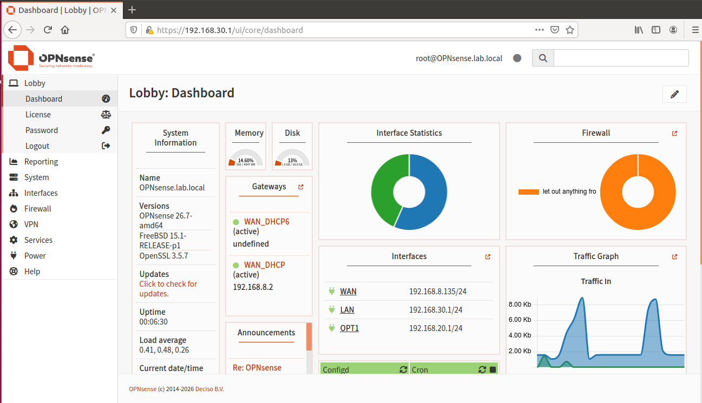
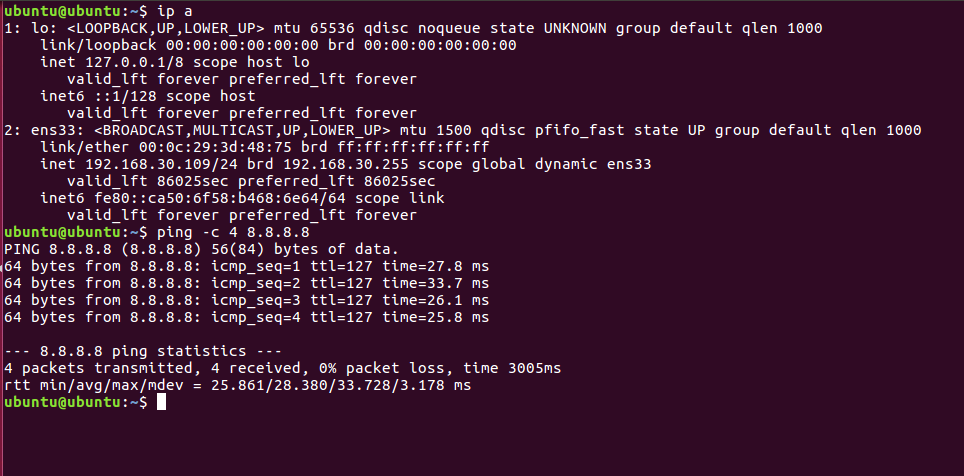
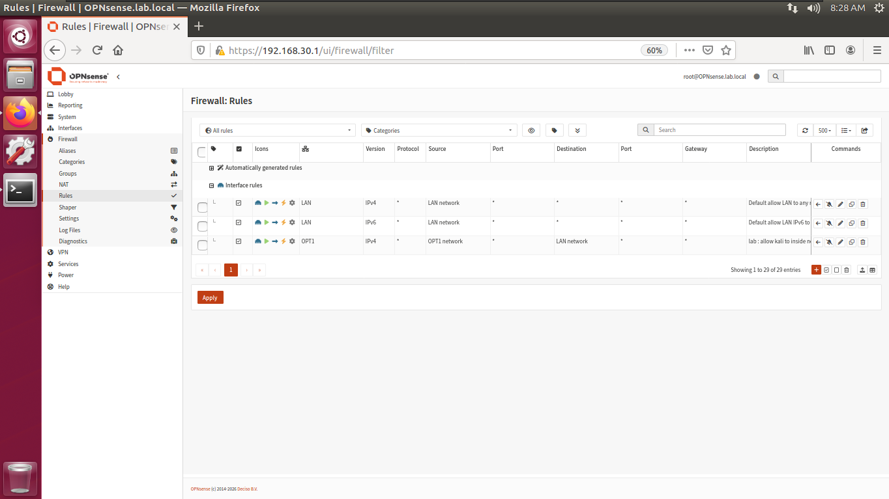
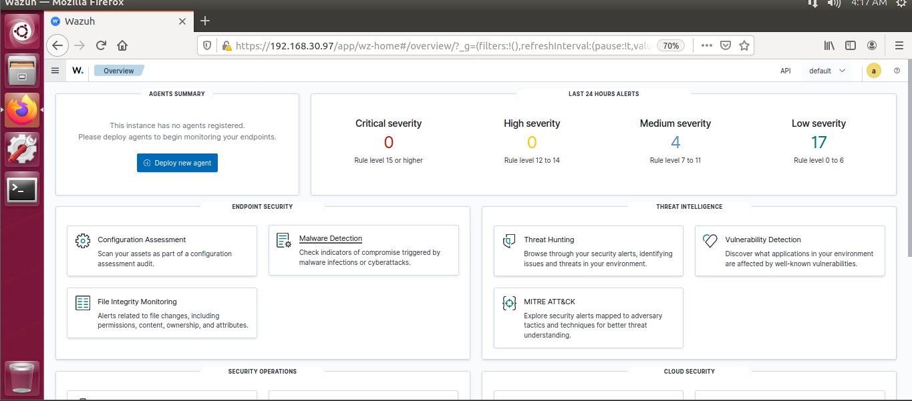

# Security Home Lab

A virtual lab to practice attack and detection.

## Goal
Attack my own machines, detect the attacks with a SIEM, and fix the weaknesses.

## Tools
VMware, OPNsense, Kali Linux, Ubuntu, Windows 7, Wazuh

## Progress

### 1. Firewall setup
OPNsense separates an "inside" and an "outside" network.

The firewall is running and managing the inside network.

Ubuntu reaches the internet through the firewall.
  ### 2. Outside network
Kali is on a separate outside network. A firewall rule allows it to reach the inside network.

### 3. SIEM setup
Wazuh monitors the inside network.

